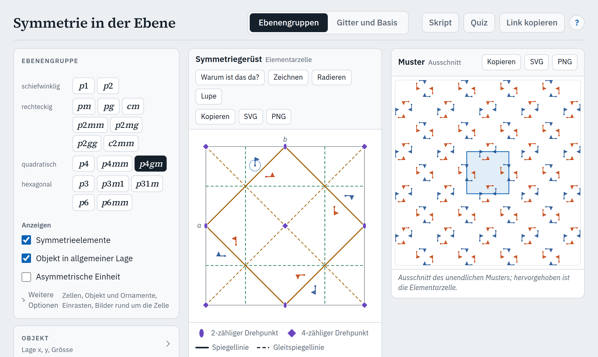

# Symmetrie in der Ebene

[](https://github.com/manganite/plane-groups/actions/workflows/ci.yml)
[](https://github.com/manganite/plane-groups/actions/workflows/deploy.yml)
[](https://github.com/manganite/plane-groups/releases)
[](LICENSE)

Interaktive Lern-App für eine Einführung in die Kristallographie, entstanden aus der Vorlesung Kristallographie an der ETH Zürich: Symmetrie periodischer Muster in der Ebene, von Gitter und Elementarzelle bis zu den 17 Ebenengruppen mit Wyckoff-Lagen und asymmetrischer Einheit. Dazu ein Skript und ein Übungsquiz. Für Laptop, iPad und Telefon; läuft im Browser, als Web-App auf dem Homescreen und offline.

Teil einer Familie von Lern-Apps mit gemeinsamer Grundlage: [crystallography-common](https://github.com/manganite/crystallography-common).

### [Zur App: manganite.github.io/plane-groups](https://manganite.github.io/plane-groups/)



## Funktionen

- **Modus „Ebenengruppen“:** Auswahl der 17 Ebenengruppen nach Kristallsystem.
  - **Symmetriegerüst:** Elementarzelle (wahlweise 2 × 2 Zellen) mit allen Symmetrieelementen und den Symbolen der International Tables for Crystallography, Vol. A. Dazu gehören die Gleitspiegellinien, die das Symbol nicht nennt (z. B. in c2mm und p4mm). Wahlweise nach Blickrichtung gefärbt.
  - **Objekt in allgemeiner Lage** (Fähnchen oder Kreis mit Komma wie in ITA) mit allen Bildern, ziehbar. Nahe einem Drehpunkt oder einer Spiegellinie rastet es ein. Die Kenndaten nennen dann Wyckoff-Lage, Lagesymmetrie und Zähligkeit.
  - **Bilder rund um die Zelle** wahlweise wie in den Diagrammen der allgemeinen Lage in ITA: auch die Bilder im Rand um die Zelle, sodass die Gruppen um Ecken und Ränder vollständig sind.
  - **Asymmetrische Einheit** einblendbar. Ihre Bedingungen in den Kenndaten (z. B. „0 ≤ x ≤ ½“) lassen sich einzeln antippen: Das Symmetriegerüst schattiert, wo die gewählten Bedingungen erfüllt sind, und hebt ihre Grenzlinien hervor; alle zusammen ergeben die asymmetrische Einheit.
  - **Muster:** Ausschnitt des unendlichen Musters mit hervorgehobener Elementarzelle.
  - **Kenndaten wie eine ITA-Seite:** Symbole, Kristallsystem, Bravais-Gitter, Punktgruppe (mit Link in die App „Stereographische Projektion“: dort das Pedion mit Flächenmuster und Blick senkrecht auf die Fläche; das Muster zeigt genau diese Punktgruppe), Ursprung, asymmetrische Einheit, Symmetrieoperationen, Wyckoff-Lagen, Auslöschungen. Jede Wyckoff-Lage lässt sich mit „setzen“ direkt ansteuern.
  - **Gitterparameter** innerhalb des Kristallsystems frei: *b*/*a* (schiefwinklig, rechteckig), γ (schiefwinklig).
  - **Symmetrie brechen** (im Abschnitt „Gitter“): *b*/*a* und γ ohne Bindung an das Kristallsystem. Es bleiben die Operationen, deren Matrix die neue Metrik erhält; die Kenndaten nennen die verbleibende Untergruppe in der Standardaufstellung der ITA mit konventioneller Zelle (z. B. p4mm mit *a* = *b*, γ ≠ 90° → c2mm mit *a*′ = *a* + *b*, *b*′ = −*a* + *b*) und was weggefallen ist. Das Symmetriegerüst zeigt nur die verbleibenden Elemente (wie die Stereo-App), die Bilder des Objekts sind nach den Bahnen der Restsymmetrie gefärbt.
  - **Selbst zeichnen:** Mit dem Werkzeug „Zeichnen“ im Symmetriegerüst ziehen: Jeder Strich erscheint mit allen Operationen der Gruppe, im Symmetriegerüst und im Muster (blau gleiche Händigkeit, orange Spiegelbild). Das Werkzeug „Radieren“ entfernt überfahrene Stücke, am Original und an allen Kopien zugleich; „Rückgängig“ macht Striche und Radieren rückgängig. „Asymmetrische Einheit füllen“ zeigt, dass ihre Bilder die Ebene ohne Lücken und Überlappungen pflastern. Die Striche bleiben im Browser gespeichert, stehen aber nicht in der Link-Adresse.
  - **Schritt für Schritt:** Das Objekt wird mit jeder Symmetrieoperation einzeln abgebildet, in der Reihenfolge der Liste in ITA (bei zentrierten Gruppen mit (½, ½)+ als 1′, 2′, …), zuletzt mit den Gittertranslationen. Die Bilder liegen zuerst dort, wohin die Koordinaten der Liste zeigen, auch ausserhalb der Zelle; der Weg zeigt, wie die Operation wirkt. Ein Zähler nennt die verschiedenen Stellen: Auf einer speziellen Lage fallen Bilder zusammen, und am Ende bleibt die Zähligkeit der Wyckoff-Lage. In den Kenndaten ist die Zeile der aktuellen Operation markiert.
  - **Aufbau aus Erzeugenden:** Die Symmetrieelemente erscheinen Schritt für Schritt. Zuerst kommen die Erzeugenden nach ITA („Generators selected“), dann, was aus ihren Verknüpfungen mit den Gittertranslationen folgt. Neue Elemente sind hervorgehoben.
  - **„Warum ist das da?“:** Ein Element antippen zeigt, aus welchen zwei Operationen es folgt (*C* = *A* ∘ *B*). Das Fähnchen läuft die Schritte ab, die passende Regel wird genannt (z. B. „Spiegelung + Translation schräg zur Linie = Gleitspiegelung“), dazu die Herleitung aus den Erzeugenden. Ist das Element nur eine Gitterkopie eines anderen (z. B. die Drehpunkte an den Ecken der Zelle), zeigt die Erklärung stattdessen das Vorbild und die Verschiebung.

- **Modus „Gitter und Basis“:** Eine Struktur aus Gitter (*b*/*a*, γ frei) und Basis aus Motiven mit eigener Symmetrie (Atom, Fähnchen 1, Windräder 2, 3, 4, 6, gleichschenkliges Dreieck m, längliche Insel 2mm, gleichseitiges Dreieck 3m, Quadrat 4mm, Sechseck 6mm), in vier Farben (Atomsorten). Motive lassen sich setzen, ziehen (mit Einrasten auf Zwölftel der Zelle), drehen, vergrössern und entfernen.
  - **Symmetrie bestimmen:** Die App bestimmt die Ebenengruppe in der Standardaufstellung der ITA mit konventioneller Zelle (*a*′, *b*′) und Ursprung und zeigt darüber Symmetrieelemente und asymmetrische Einheit. Die Kenndaten nennen je Motiv Lage, Wyckoff-Lage und Lagesymmetrie und, nach einer Änderung, wie sich die Gruppe geändert hat. Ein Knopf öffnet die Gruppe im Modus „Ebenengruppen“.
  - **Vorgaben:** die fünf Bravais-Gitter; ein Dreiecksbeispiel in drei Stufen (pm → cm → p2mg); 2D-Materialien in Draufsicht (Graphen, h-BN, MoS₂ 1H, Kagome, Lieb-Gitter); die Archimedischen Parkettierungen 4.8.8, 3.4.6.4, 3.3.4.3.4 und 3.3.3.3.6 (chiral); Mauerwerk und Pflaster aus Ziegeln 2 : 1 (ohne Versatz, Läuferverband, um ein Drittel versetzt, Fischgrät- und Flechtverband); künstliches Spin-Eis (square, kagome, pinwheel). Bindungen zwischen nächsten Nachbarn wahlweise.

- **Muster als Tapete und Ornamente:** Das Muster ohne Zelle und Elemente, einfarbig, mit Ornamenten (Blatt, Tropfen, Ranke) statt des Fähnchens; Vergrösserung des Musters und Grösse des Objekts frei. Eine **Lupe** vergrössert das Symmetriegerüst um das Objekt.
- **Kenndaten** mit Schoenflies-Symbol und Signatur nach Conway.
- **Kopieren und Speichern** je Tafel: Bild in die Zwischenablage, als SVG oder PNG.

- **[Skript](https://manganite.github.io/plane-groups/skript.html)** mit sieben Kapiteln: Gitter, Elementarzelle und Basis; Symmetrie des Gitters; Gitter und Motiv; Gleitspiegelung und Verknüpfung; die 17 Ebenengruppen; Punktlagen; Tapeten, Ornamente und Kunst. Die Abbildungen zeichnet der Code der App, jede mit Link in die App; Vertiefungen sind gekennzeichnet. Auch als [PDF](https://manganite.github.io/plane-groups/skript.pdf) und als Anhang jedes Releases.
- **[Quiz](https://manganite.github.io/plane-groups/quiz.html)** zu allen Kapiteln in drei Stufen (1 Grundlagen, 2 Anwendung, 3 Vertiefung; Stufe 3 bedeutet mehr Stoff, nicht unbedingt schwierigere Fragen): handgeschriebene Fragen und Fragengeneratoren, Bilder aus dem Code der App, sofortige Rückmeldung mit Link ins Skript und in die passende Ansicht der App. Standardmässig erscheinen nur fachlich geprüfte Fragen; „Auch ungeprüfte Fragen zeigen“ (oder `quiz.html?entwurf`) nimmt die Entwürfe dazu. Der Stand bleibt nur im Browser.

## Nutzung

### Im Browser

Die App läuft in aktuellen Versionen von Safari, Chrome, Edge und Firefox: **https://manganite.github.io/plane-groups/**. Eine Installation ist nicht nötig. Einstellungen bleiben im Browser gespeichert; „Link kopieren“ erzeugt einen Link auf genau die aktuelle Ansicht, etwa für Folien.

### Als Web-App auf dem Homescreen

Die App lässt sich wie eine installierte App mit eigenem Symbol und ohne Browserleiste starten:

- **iPad und iPhone (Safari):** App öffnen, auf das Teilen-Symbol tippen (Quadrat mit Pfeil nach oben), dann **„Zum Home-Bildschirm“** und **„Hinzufügen“**.
- **Android (Chrome):** App öffnen, Menü **⋮** antippen, dann **„Zum Startbildschirm hinzufügen“** bzw. **„App installieren“**.
- **Laptop (Chrome oder Edge):** App öffnen, in der Adressleiste auf das Symbol **„App installieren“** klicken (Chrome) bzw. Menü **…** → **Apps** → **„Diese Website als App installieren“** (Edge).

### Offline

Nach dem ersten Aufruf hält ein Service Worker alle Dateien vor; die App funktioniert dann auch ohne Netz, im Browser wie auf dem Homescreen. Erscheint eine neue Version, lädt die App sie beim nächsten Öffnen mit Netz und startet einmal neu; Einstellungen bleiben erhalten.

### Lokal ausführen

Die App ist eine statische Webseite ohne Build-Schritt und ohne Abhängigkeiten.

1. Dateien holen: auf der [Release-Seite](https://github.com/manganite/plane-groups/releases/latest) unter „Assets“ **Source code (zip)** herunterladen und entpacken, oder
   ```bash
   git clone https://github.com/manganite/plane-groups.git
   ```
2. Im Ordner einen lokalen Webserver starten, zum Beispiel mit Python 3:
   ```bash
   cd plane-groups
   python3 -m http.server 8000
   ```
   (unter Windows `py -m http.server 8000`)
3. Im Browser **http://localhost:8000** öffnen.

Ein Doppelklick auf `index.html` genügt nicht: Browser laden die JavaScript-Module der App nicht von `file://`-Adressen.


## Link-Adressen

Der Zustand steht lesbar in der Adresse, z. B. `#m=eg&g=p4gm&x=0.12&y=0.31`. Geschrieben wird nur, was vom Startzustand abweicht; Schalter mit `1` (ein) und `0` (aus). Die Link-Adressen sind eine Schnittstelle (Skript, Quiz, andere Apps der Familie) und bleiben stabil (Test `tests/zustand.test.mjs`):

| Schlüssel | Bedeutung | Werte (Startwert fett) |
|---|---|---|
| `m` | Modus | **`eg`** (Ebenengruppen), `struktur` (Gitter und Basis, Schlüssel unten) |
| `g` | Ebenengruppe | Symbol wie in ITA, z. B. `p4gm`, `p31m`; **`p2mg`** |
| `x`, `y` | Lage des Objekts in Bruchkoordinaten | Zahl oder Bruch (z. B. `1/3`; spezielle Lagen werden als Bruch geschrieben), **`0.12`**, **`0.31`** |
| `el` | Symmetrieelemente | `0`, **`1`** |
| `obj` | Objekt in allgemeiner Lage | `0`, **`1`** |
| `ae` | asymmetrische Einheit | **`0`**, `1` |
| `zellen` | Zellen im Symmetriegerüst | **`1`**, `2` (2 × 2) |
| `form` | Form des Objekts | **`fahne`**, `komma` (Kreis mit Komma wie ITA), Ornamente `blatt`, `tropfen`, `ranke` |
| `og` | Grösse des Objekts (Faktor) | 0.5–3, **1** |
| `rast` | Einrasten auf spezielle Lagen | `0`, **`1`** |
| `orbit` | Bilder rund um die Zelle (wie ITA) | **`0`**, `1` |
| `fuell` | asymmetrische Einheit gefüllt und vervielfältigt | **`0`**, `1` |
| `farb` | nach Blickrichtung färben | `0`, **`1`** |
| `mel` | Symmetrieelemente im Muster | **`0`**, `1` |
| `tap` | Muster als Tapete (ohne Zelle und Elemente, einfarbig) | **`0`**, `1` |
| `zoom` | Vergrösserung des Musters | 0.5–3, **1** |
| `lupe` | Lupe: Symmetriegerüst um das Objekt vergrössert | **`0`**, `1` |
| `schritt` | Schritt für Schritt | **`0`** (aus), Operation `1` … *N* der Liste, *N* + 1 Gittertranslationen |
| `aufbau` | Aufbau aus Erzeugenden | **`0`** (aus), Schritt `1`, `2`, … |
| `warum` | Werkzeug „Warum ist das da?“ | **`0`**, `1` |
| `aet` | angetippte Bedingungen der asymmetrischen Einheit | Nummern ab `0` in der Reihenfolge der ITA-Seite, z. B. `0,2`; **leer** |
| `erkl` | erklärtes Element | z. B. `4;1/2,1/2` (4-zähliger Drehpunkt bei ½, ½), `m;1/4,0;0,1` (Spiegellinie durch ¼, 0 in Richtung [01]), `g;…` (Gleitspiegellinie) |
| `brechen` | Gitter ohne Bindung an das Kristallsystem (Symmetrie brechen; nicht schiefwinklig) | **`0`**, `1`; dann `ba` 0.5–2 und `gamma` 60–150 frei |
| `ba` | *b*/*a* (nur schiefwinklig, rechteckig) | 0.6–1.6; **1.25** bzw. **1.35** |
| `gamma` | γ in Grad (nur schiefwinklig) | 95–125; **105** |

Im Modus „Gitter und Basis“ (`m=struktur`):

| Schlüssel | Bedeutung | Werte (Startwert fett) |
|---|---|---|
| `v` | Vorgabe, unverändert | Kennung aus `js/vorgaben.js`, z. B. `graphen`, `a33434`, `asi-pinwheel`; **`dreieck1`** |
| `ba`, `gamma` | Gitter, wenn Gitter oder Basis von der Vorgabe abweichen | 0.5–2 bzw. 60–150 |
| `basis` | Basis, wenn verändert: Motive durch `;` getrennt, je `motiv,farbe,x,y,winkel[,grösse]` | z. B. `atom,0,1/3,2/3,0;atom,1,2/3,1/3,0` (h-BN); Motive wie in `js/motive.js`, Farbe `0`–`3`, Winkel in Grad |
| `sel` | Symmetrieelemente | `0`, **`1`** |
| `szelle` | konventionelle Zelle | `0`, **`1`** |
| `sae` | asymmetrische Einheit | **`0`**, `1` |
| `sbind` | Bindungen zwischen nächsten Nachbarn | `0`, **`1`** |
| `zoom` | Vergrösserung des Musters | 0.5–3, **1** |


## Konventionen

- Diagramme wie in International Tables for Crystallography, Vol. A (2006), Abschn. 2.2.6.1 und 2.2.6.4: *a* zeigt nach unten, *b* nach rechts, Ursprung oben links.
- Symbole der Symmetrieelemente, Koordinaten (Querstrich statt Minus, Brüche), Symmetrieoperationen, Wyckoff-Lagen und Auslöschungen nach ITA Part 6. Gezeichnet werden auch die Gleitspiegellinien, die das Symbol nicht nennt.
- Ebenengruppen in der Standardaufstellung der ITA; bestimmte Gruppen (Modus „Gitter und Basis“, „Symmetrie brechen“) mit konventioneller Zelle *a*′, *b*′ und Ursprung.
- Kristallsysteme der Ebene: schiefwinklig, rechteckig, quadratisch, hexagonal (Begriff „rechteckig“ wie bei Hoffmann).
- Dezimalkomma in Oberfläche und Skript, Dezimalpunkt in der Link-Adresse.
- Eigene Festlegungen der App: Bereiche der Gitterregler (*b*/*a* 0,6–1,6, γ 95–125°, so dass keine höhere Symmetrie entsteht; beim Brechen 0,5–2 und 60–150°); Bilder des Objekts blau bei gleicher Händigkeit, orange als Spiegelbild; Namen der Operationen in den Punktgruppen (Spiegelungen nach der Normalen der Linie, Skript Abschn. 4.4).

## Entwicklung

### Aufbau

| Datei | Inhalt |
|---|---|
| `index.html`, `js/main.js` | Oberfläche und Steuerung der App: Zustand, Bedienelemente, Tafeln, Kenndaten |
| `js/zustand.js` | Zustand und Link-Adresse (Schnittstelle, siehe oben) |
| `js/ebenengruppen.js` | Die 17 Ebenengruppen nach ITA Part 6 (nur Angaben, die sich nicht berechnen lassen) |
| `js/symmetrie.js` | Rechenkern: Operationen, Verknüpfung, Symmetrieelemente, Lagen, Auslöschungen |
| `js/asymmetrie.js` | Asymmetrische Einheit aus den Bedingungen der ITA-Seite |
| `js/zeichnung.js` | SVG-Zeichnungen: Symmetriegerüst (Tafel A) und Muster (Tafel B), ohne DOM |
| `js/text.js`, `js/symbole.js` | Schreibweise der Kenndaten wie in ITA; Schoenflies-Symbole und Signaturen nach Conway |
| `js/schritte.js`, `js/herkunft.js`, `js/warum.js` | „Schritt für Schritt“, „Aufbau aus Erzeugenden“ und „Warum ist das da?“ |
| `js/brechen.js` | „Symmetrie brechen“: verbleibende Untergruppe |
| `js/punktoperationen.js` | Operationen der Punktgruppen der Ebene mit Namen wie im Skript |
| `js/struktur.js`, `js/struktur-ui.js`, `js/bestimmung.js`, `js/motive.js`, `js/vorgaben.js` | Modus „Gitter und Basis“: Tafeln und Kenndaten, Bedienung, Bestimmung der Ebenengruppe, Motive, Vorgaben |
| `js/verweise.js` | Links in die App „Stereographische Projektion“ (Punktgruppe einer Ebenengruppe) |
| `js/hilfetexte.js` | Texte der Tooltips und ⓘ-Erklärungen |
| `skript.html`, `js/skript.js`, `js/skizzen.js` | Skript; Abbildungen aus Link-Adressen der App, Skizzen für Skript und Quiz |
| `quiz.html`, `js/quiz.js`, `js/quiz-kapitel.js` | Quiz: Ablauf aus `lib/common/`, Kapitel und Speicher dieser App |
| `js/quiz-bank.js`, `js/quiz-gen.js`, `js/quiz-bild.js` | Handgeschriebene Fragen (mit Quelle und Prüfstatus), Generatoren für erzeugte Fragen, Bilder aus der App |
| `tools/moodle-export.mjs`, `tools/skript-pdf.mjs` | Moodle-Export und PDF des Skripts |
| `tools/quiz-quelle.mjs` | Fragen und Bilder für die gemeinsame Fragenliste der App-Familie (crystallography-common, `fragenliste/`) |
| `js/version.js`, `sw.js` | Versionsnummer, Service Worker für den Offline-Betrieb |
| `manifest.webmanifest`, `icons/` | Favicon und Homescreen-Icons |
| `lib/common/`, `tools/common/` | Gemeinsame Grundlage aus [crystallography-common](https://github.com/manganite/crystallography-common) als Kopie mit fester Version (`lib/common/MANIFEST.json`): Stile, Schriften, Hilfen, Quiz, Skript-Bausteine, Formatierung, Werkzeuge. Nicht von Hand ändern. |
| `tests/` | Automatische Tests (Node, ohne Abhängigkeiten); gemeinsame Helfer der Tests in `tests/hilfen.mjs` |
| `tsconfig.json` | Typprüfung mit TypeScript (JSDoc-Typen, kein Build-Schritt) |
| `docs/` | Konzept der App (`konzept-2d-app.md`), Bilder für README und GitHub |

### Gemeinsame Grundlage

Die App gehört zu einer Familie von Lern-Apps mit gleichem Aussehen, gleicher Bedienung und gleich aufgebautem Skript und Quiz. Was sich teilen lässt, liegt in [crystallography-common](https://github.com/manganite/crystallography-common), dort steht auch der [Leitfaden](https://github.com/manganite/crystallography-common/blob/main/LEITFADEN.md). Eine neue Version übernimmt man von einem Release-Tag:

```bash
node tools/common/sync.mjs ../crystallography-common
```

`tests/common.test.mjs` prüft, dass die Kopie dem Manifest entspricht. Änderungen an gemeinsamen Dateien gehören nach crystallography-common, nicht in die Kopie.

### Tests

```bash
node --test tests/*.test.mjs
```

Geprüft werden die Daten aller 17 Ebenengruppen gegen die Rechnung (ITA Part 6), die Zeichnungen (Metrik, Zuordnung der Linien zu den Blickrichtungen), Schoenflies-Symbole und Signaturen, „Schritt für Schritt“, die Herkunft der Elemente aus den Erzeugenden, „Symmetrie brechen“, „Selbst zeichnen“, der Modus „Gitter und Basis“ (Strukturen aus allen 17 Gruppen werden wiedererkannt, auch mit verschobenem Ursprung), die Link-Adressen (hin und zurück), die Quizfragen (Aufbau, Bezug zum Skript, Bilder, Antworten nach Büchern nachgerechnet, Moodle-Export) sowie die Release-Konsistenz (Version, Changelog, Offline-Liste), die Kopie der gemeinsamen Dateien und dass App, Skript und README keine Verweise auf Lehrveranstaltungen enthalten. Dieselben Tests laufen bei jedem Pull Request in GitHub Actions, zusammen mit Typprüfung, ESLint und der PDF-Fassung des Skripts.

Typprüfung und ESLint (die Typen stehen als JSDoc-Kommentare im Code, die Regeln für ESLint in `tools/common/eslint-basis.mjs`; Versionen wie in den Jobs `typen` und `lint` in `.github/workflows/ci.yml`, alle Pakete in einem Befehl, sonst entfernt npm die zuvor installierten):

```bash
npm install --no-save typescript@7.0.2 @types/node@22.20.5 playwright@1.52.0 eslint@10.14.0 @eslint/js@10.0.1 globals@17.14.0
npx tsc -p .
npx eslint .
```

Strikt geprüft werden alle Dateien in `js/`, `tools/` und `tests/`. Mit den installierten Paketen zeigt auch VS Code die Meldungen der Typprüfung in geöffneten Dateien (die von ESLint mit der Erweiterung „ESLint“).

- Skript als PDF: `node tools/skript-pdf.mjs [Ausgabedatei]` (braucht Playwright mit Chromium)
- Quiz für Moodle: `node tools/moodle-export.mjs quiz.xml` (mit `--entwurf` auch die ungeprüften Fragen)
- Prüfung und Rückmeldungen zum Quiz: in der gemeinsamen Fragenliste der App-Familie (crystallography-common, `fragenliste/`). Eine Frage wird erst „geprüft“, wenn sie dort fachlich freigegeben ist.

### Versionen und Releases

Die App folgt [Semantic Versioning](https://semver.org/lang/de/); Änderungen stehen im [CHANGELOG](CHANGELOG.md). Jede Änderung geht über einen Branch und einen Pull Request nach `main` (`main` ist geschützt; die CI muss grün sein). Die Live-Seite ändert sich nur mit einem Release:

1. Release-PR: Version in `js/version.js`, `sw.js` und `CITATION.cff` (mit `date-released`) erhöhen; in `CHANGELOG.md` die Einträge unter `## [Unreleased]` unter eine neue Überschrift `## [x.y.z] - JJJJ-MM-TT` verschieben und die Links am Ende ergänzen.
2. Nach dem Merge den Tag auf den neuesten Stand von `main` setzen:
   ```bash
   git fetch && git log --oneline -1 origin/main     # ist das der Release-PR?
   git -c user.email=6277652+manganite@users.noreply.github.com tag -a vX.Y.Z -m "vX.Y.Z" origin/main
   git push origin vX.Y.Z
   ```

   Die Noreply-Adresse ist nötig, weil GitHub sonst einen Tag mit privater E-Mail-Adresse ablehnt (GH007).

Der Tag startet zwei Workflows: `release.yml` legt das GitHub-Release mit den Notizen aus dem Changelog und dem Skript als PDF an, `deploy.yml` prüft und veröffentlicht den Stand auf GitHub Pages.

## Grundlagen und Quellen

- International Tables for Crystallography, Vol. A, 5. Aufl., hrsg. von Th. Hahn, Springer, Dordrecht 2006, Abschn. 2.2 und Part 6: Diagramme, Symbole, Symmetrieoperationen, Wyckoff-Lagen, asymmetrische Einheit, Auslöschungen; Grundlage der Daten und Tests.
- W. Borchardt-Ott, H. Sowa: *Kristallographie. Eine Einführung für Studierende der Naturwissenschaften*, Springer, Berlin 2018, [doi:10.1007/978-3-662-56816-3](https://doi.org/10.1007/978-3-662-56816-3): Begriffe (Gitter, Basis, Elementarzelle, Ebenengruppen, Punktlagen).
- F. Hoffmann: *Faszination Kristalle und Symmetrie. Einführung in die Kristallographie*, Springer Fachmedien, Wiesbaden 2016, [doi:10.1007/978-3-658-09581-9](https://doi.org/10.1007/978-3-658-09581-9): Muster in Alltag und Kunst, Mauerwerk, Parkettierungen, Netzebenen.
- J. H. Conway, H. Burgiel, C. Goodman-Strauss: *The Symmetries of Things*: Signaturen (Orbifold-Notation), Farbsymmetrie.

Die Quellen je Kapitel stehen im Skript.

## Entstehung

Fachautor ist Thomas Lottermoser (ETH Zürich). Code, Skript und Quiz sind mit Hilfe von [Claude Code](https://claude.com/claude-code), einem KI-Werkzeug von Anthropic, entstanden. Fachliche Aussagen stützen sich auf die genannten Quellen und sind, wo möglich, in Tests nachgerechnet. Skript und Quiz gibt der Autor fachlich frei; Quizfragen erscheinen erst nach dieser Freigabe.

## Rückmeldungen

Fehler, fachliche Hinweise zu Skript und Quiz und Vorschläge bitte als [Issue](https://github.com/manganite/plane-groups/issues/new/choose). Sicherheitslücken nicht öffentlich melden, sondern wie in [SECURITY.md](SECURITY.md) beschrieben.

## Zitieren

Wer die App in Lehre oder Publikationen nennt, findet die Angaben in [`CITATION.cff`](CITATION.cff) bzw. auf GitHub unter „Cite this repository“.

## Lizenz

Die App steht unter der MIT-Lizenz ([`LICENSE`](LICENSE)). Die Schriften in `lib/common/fonts/` stehen unter der SIL Open Font License 1.1 (Lizenztexte liegen bei).
